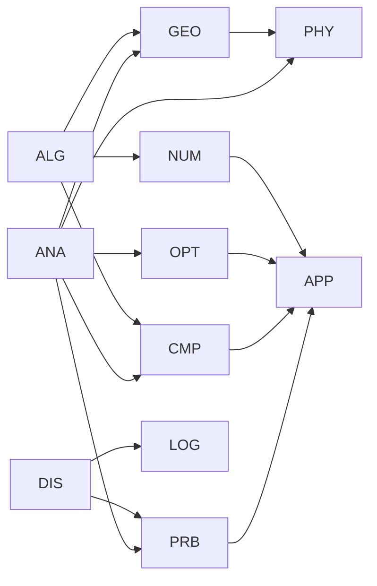

# Catalogue of Disciplines

This is the master list of courses in the series. Each course belongs to one
**area** and one **level**, and lists its **prerequisites**. Later stages
(learning paths, syllabi, materials) build on this catalogue.

## Conventions

**Audience.** The series is designed for self-study. Learners are assumed to be
comfortable reading and writing proofs (basic logic, sets, functions,
induction) before starting; there is no separate foundations course.

**Course codes** are `AREA` + three digits. The first digit is the level:

| Level | Meaning | Rough equivalent |
|---|---|---|
| 1xx | Entry | First university year |
| 2xx | Core | Second year |
| 3xx | Advanced undergraduate | Third/fourth year |
| 4xx | Graduate core | Master's / first-year PhD |
| 5xx | Specialized | Advanced graduate, research topics |

**Areas**

| Code | Area |
|---|---|
| ANA | Analysis |
| ALG | Algebra (including algebraic geometry) |
| GEO | Geometry and topology |
| NUM | Number theory |
| DIS | Discrete mathematics and combinatorics |
| LOG | Logic and foundations of mathematics |
| PRB | Probability and statistics |
| CMP | Numerical and computational mathematics |
| OPT | Optimization and control |
| APP | Applied mathematics and interdisciplinary topics |
| PHY | Mathematical physics |

## How the areas depend on each other

---

## ANA — Analysis

| Code | Course | Prerequisites | Key topics |
|---|---|---|---|
| ANA101 | Calculus I: Single Variable | — | Limits, continuity, derivatives, integrals, Taylor series |
| ANA102 | Calculus II: Multivariable and Vector Calculus | ANA101, ALG101 | Partial derivatives, multiple integrals, line/surface integrals, Green, Stokes, Gauss |
| ANA201 | Ordinary Differential Equations | ANA101, ALG101 | First-order equations, linear systems, Laplace transform, existence and uniqueness, stability |
| ANA202 | Real Analysis I | ANA101 | Construction of ℝ, sequences and series, continuity, Riemann integral, uniform convergence |
| ANA203 | Real Analysis II | ANA202, ANA102 | Metric spaces, analysis in ℝⁿ, inverse and implicit function theorems, differential forms |
| ANA301 | Complex Analysis | ANA202 | Holomorphic functions, Cauchy theory, residues, conformal maps, analytic continuation |
| ANA302 | Partial Differential Equations | ANA102, ANA201 | Heat, wave and Laplace equations, separation of variables, characteristics, maximum principles |
| ANA303 | Fourier Analysis | ANA202 | Fourier series and transform, convergence, Plancherel, applications |
| ANA304 | Calculus of Variations | ANA203, ANA201 | Euler–Lagrange equations, constraints, Noether's theorem, direct method |
| ANA305 | Dynamical Systems and Chaos | ANA201, ALG101 | Phase portraits, bifurcations, limit cycles, discrete maps, chaos, fractals |
| ANA401 | Measure Theory and Integration | ANA203 | σ-algebras, Lebesgue measure and integral, convergence theorems, Lᵖ spaces, product measures |
| ANA402 | Functional Analysis | ANA401, ALG201 | Banach and Hilbert spaces, Hahn–Banach, open mapping, compact operators, spectral theorem |
| ANA403 | Harmonic Analysis | ANA401, ANA303 | Singular integrals, maximal functions, interpolation, Littlewood–Paley theory |
| ANA404 | Modern Theory of PDEs | ANA402, ANA302 | Distributions, Sobolev spaces, weak solutions, elliptic regularity, evolution equations |
| ANA405 | Several Complex Variables | ANA301, ANA401 | Hartogs phenomena, pseudoconvexity, ∂̄-problem |
| ANA406 | Ergodic Theory | ANA401, ANA305 | Invariant measures, ergodic theorems, mixing, entropy |
| ANA501 | Spectral Theory and Operator Algebras | ANA402 | Unbounded operators, C*- and von Neumann algebras |
| ANA502 | Microlocal Analysis | ANA404, ANA403 | Pseudodifferential operators, wave front sets, propagation of singularities |
| ANA503 | Geometric Measure Theory | ANA401, GEO401 | Hausdorff measure, rectifiability, currents, minimal surfaces |

## ALG — Algebra (including algebraic geometry)

| Code | Course | Prerequisites | Key topics |
|---|---|---|---|
| ALG101 | Linear Algebra I | — | Linear systems, matrices, vector spaces, determinants, eigenvalues |
| ALG201 | Linear Algebra II | ALG101 | Abstract vector spaces, inner products, spectral theorem, Jordan form, duality, tensor products |
| ALG202 | Abstract Algebra I: Groups and Rings | ALG101 | Groups, homomorphisms, group actions, Sylow theorems, rings, ideals, PIDs and UFDs |
| ALG301 | Abstract Algebra II: Fields, Modules and Galois Theory | ALG202, ALG201 | Field extensions, Galois theory, finite fields, modules over PIDs |
| ALG302 | Representation Theory of Finite Groups | ALG301 | Characters, Maschke's theorem, induced representations, symmetric group |
| ALG303 | Introduction to Algebraic Curves | ALG301 | Plane curves, Bézout's theorem, projective geometry, genus |
| ALG401 | Commutative Algebra | ALG301 | Noetherian rings, localization, primary decomposition, dimension theory, Nullstellensatz |
| ALG402 | Homological Algebra and Category Theory | ALG301 | Categories, functors, adjunctions, abelian categories, derived functors, Ext and Tor |
| ALG403 | Lie Groups and Lie Algebras | ALG302, GEO401 | Exponential map, semisimple Lie algebras, root systems, classification |
| ALG404 | Advanced Group Theory | ALG301 | Presentations, solvable and nilpotent groups, finite simple groups |
| ALG405 | Algebraic Geometry I: Varieties | ALG401 | Affine and projective varieties, morphisms, dimension, smoothness |
| ALG501 | Advanced Representation Theory | ALG403, ALG402 | Highest-weight theory, category O, quantum groups |
| ALG502 | Higher Categories and Homotopical Algebra | ALG402, GEO403 | Model categories, ∞-categories, simplicial methods |
| ALG503 | Algebraic Geometry II: Schemes and Cohomology | ALG405, ALG402 | Schemes, sheaves, sheaf cohomology, Riemann–Roch |

## GEO — Geometry and topology

| Code | Course | Prerequisites | Key topics |
|---|---|---|---|
| GEO201 | Geometry: Euclidean, Projective and Non-Euclidean | ALG101 | Axiomatic geometry, isometry groups, projective plane, hyperbolic geometry |
| GEO301 | Point-Set Topology | ANA202 | Topological spaces, compactness, connectedness, separation axioms, quotients |
| GEO302 | Differential Geometry of Curves and Surfaces | ANA203, ALG201 | Curvature, torsion, fundamental forms, Gauss's Theorema Egregium, Gauss–Bonnet |
| GEO303 | Introduction to Knot Theory | GEO301, ALG202 | Knot diagrams, Reidemeister moves, knot invariants and polynomials |
| GEO401 | Smooth Manifolds | GEO301, ANA203 | Manifolds, tangent bundles, vector fields, differential forms, Stokes, de Rham cohomology |
| GEO402 | Algebraic Topology I | GEO301, ALG202 | Fundamental group, covering spaces, simplicial and singular homology |
| GEO403 | Algebraic Topology II | GEO402, ALG402 | Cohomology, cup products, Poincaré duality, higher homotopy groups |
| GEO404 | Riemannian Geometry | GEO401, GEO302 | Connections, geodesics, curvature, Jacobi fields, comparison theorems |
| GEO405 | Riemann Surfaces | ANA301, GEO402 | Holomorphic maps, uniformization, divisors, Riemann–Roch for curves |
| GEO501 | Differential Topology | GEO401, GEO403 | Transversality, Morse theory, cobordism, vector bundles, characteristic classes |
| GEO502 | Symplectic and Contact Geometry | GEO401 | Symplectic manifolds, Darboux, Hamiltonian flows, moment maps |
| GEO503 | Geometric Group Theory | GEO402, ALG404 | Cayley graphs, quasi-isometries, hyperbolic groups |
| GEO504 | Homotopy Theory and K-Theory | GEO403 | Fibrations, spectral sequences, stable homotopy, topological K-theory |
| GEO505 | Low-Dimensional Topology | GEO403 | 3-manifolds, Heegaard splittings, 4-manifolds, gauge-theoretic invariants |

## NUM — Number theory

| Code | Course | Prerequisites | Key topics |
|---|---|---|---|
| NUM201 | Elementary Number Theory | — | Divisibility, congruences, quadratic reciprocity, arithmetic functions, continued fractions |
| NUM401 | Algebraic Number Theory | ALG301 | Number fields, rings of integers, ideal factorization, class groups, Dirichlet unit theorem, p-adic numbers |
| NUM402 | Analytic Number Theory | ANA301, NUM201 | Riemann zeta function, prime number theorem, Dirichlet L-functions, sieve methods |
| NUM403 | Elliptic Curves | NUM401, ALG303 | Group law, Mordell–Weil, curves over finite fields, isogenies |
| NUM501 | Modular Forms and L-Functions | NUM402, GEO405 | Modular group, Hecke operators, L-functions, connections to elliptic curves |
| NUM502 | Class Field Theory | NUM401, ALG402 | Local and global class field theory, Galois cohomology |
| NUM503 | Arithmetic Geometry | ALG503, NUM403 | Varieties over number fields, heights, étale cohomology |

## DIS — Discrete mathematics and combinatorics

| Code | Course | Prerequisites | Key topics |
|---|---|---|---|
| DIS101 | Discrete Mathematics | — | Counting, recurrences, generating functions, introductory graph theory |
| DIS201 | Combinatorics | DIS101, ALG101 | Enumeration, inclusion–exclusion, partitions, designs, Ramsey theory |
| DIS202 | Graph Theory | DIS101 | Connectivity, matchings, colouring, planarity, flows, spectral graph theory |
| DIS301 | Algebraic Combinatorics | DIS201, ALG202 | Symmetric functions, Young tableaux, Pólya theory, posets |
| DIS302 | Extremal and Probabilistic Combinatorics | DIS201, PRB201 | Probabilistic method, Turán-type problems, random graphs |
| DIS401 | Additive Combinatorics | DIS302, NUM201, ANA303 | Sumsets, Szemerédi's theorem, Fourier-analytic methods |

## LOG — Logic and foundations of mathematics

| Code | Course | Prerequisites | Key topics |
|---|---|---|---|
| LOG201 | Mathematical Logic | — | First-order logic, completeness, compactness, Gödel's incompleteness theorems |
| LOG301 | Computability and Complexity | LOG201, DIS101 | Turing machines, decidability, recursion theory, P vs NP |
| LOG302 | Axiomatic Set Theory | LOG201 | ZFC, ordinals, cardinals, axiom of choice, constructible universe |
| LOG303 | Formalized Mathematics and Proof Assistants | ALG202 | Dependent type theory, Lean, formalizing proofs |
| LOG401 | Model Theory | LOG201, ALG301 | Types, saturation, quantifier elimination, stability |
| LOG402 | Proof Theory and Type Theory | LOG301 | Cut elimination, ordinal analysis, λ-calculus, homotopy type theory |
| LOG501 | Forcing and Large Cardinals | LOG302 | Independence proofs, forcing, large cardinal axioms |

## PRB — Probability and statistics

| Code | Course | Prerequisites | Key topics |
|---|---|---|---|
| PRB201 | Probability | ANA102 | Probability spaces, random variables, distributions, expectation, limit theorems |
| PRB202 | Statistics | PRB201 | Estimation, confidence intervals, hypothesis testing, introductory regression |
| PRB301 | Mathematical Statistics | PRB202, ANA202 | Sufficiency, likelihood theory, asymptotic statistics, optimal tests |
| PRB302 | Stochastic Processes | PRB201, ALG101 | Markov chains, Poisson processes, renewal theory, discrete martingales |
| PRB303 | Linear Models and Regression | PRB202, ALG201 | Least squares, ANOVA, generalized linear models, model selection |
| PRB401 | Measure-Theoretic Probability | ANA401, PRB201 | Conditional expectation, martingales, weak convergence, Brownian motion |
| PRB402 | Stochastic Calculus | PRB401 | Itô integral, Itô's formula, SDEs, Girsanov theorem |
| PRB403 | Bayesian Statistics and Decision Theory | PRB301 | Priors, posterior computation, admissibility, minimax |
| PRB404 | High-Dimensional Probability and Statistical Learning Theory | PRB401, PRB301 | Concentration of measure, empirical processes, VC theory, sparse estimation |
| PRB501 | Random Matrix Theory | PRB401, ANA402 | Wigner and Wishart matrices, semicircle law, universality |
| PRB502 | Large Deviations and Interacting Particle Systems | PRB401 | Cramér and Sanov theorems, percolation, Ising model |

## CMP — Numerical and computational mathematics

| Code | Course | Prerequisites | Key topics |
|---|---|---|---|
| CMP201 | Numerical Analysis | ANA101, ALG101 | Floating point, root finding, interpolation, quadrature, error analysis |
| CMP301 | Numerical Linear Algebra | CMP201, ALG201 | Matrix factorizations, conditioning, iterative solvers, eigenvalue algorithms |
| CMP302 | Numerical Methods for Differential Equations | CMP201, ANA201, ANA302 | Runge–Kutta and multistep methods, stability, finite differences |
| CMP303 | Computational Algebra and Symbolic Computation | ALG301 | Gröbner bases, polynomial algorithms, computer algebra systems |
| CMP401 | Finite Element Methods | CMP302, ANA402 | Variational formulations, Galerkin methods, error estimates |
| CMP402 | Approximation Theory | CMP201, ANA303 | Best approximation, splines, orthogonal polynomials, wavelets |

## OPT — Optimization and control

| Code | Course | Prerequisites | Key topics |
|---|---|---|---|
| OPT301 | Linear and Nonlinear Optimization | ALG201, ANA203 | Linear programming, simplex, duality, KKT conditions, gradient methods |
| OPT302 | Convex Analysis and Optimization | OPT301 | Convex sets and functions, subgradients, conic programming, interior-point methods |
| OPT401 | Optimal Control Theory | ANA304, ANA201 | Pontryagin maximum principle, dynamic programming, Hamilton–Jacobi–Bellman |
| OPT402 | Combinatorial Optimization | OPT301, DIS202 | Integer programming, matroids, network flows, approximation algorithms |

## APP — Applied mathematics and interdisciplinary topics

| Code | Course | Prerequisites | Key topics |
|---|---|---|---|
| APP301 | Mathematical Modelling | ANA201, PRB201 | Model building, dimensional analysis, case studies |
| APP302 | Information Theory | PRB201 | Entropy, source and channel coding theorems, rate–distortion |
| APP303 | Cryptography | NUM201, ALG202 | Public-key systems, discrete logarithms, lattices, provable security |
| APP304 | Coding Theory | ALG301, DIS201 | Linear codes, bounds, cyclic and Reed–Solomon codes, LDPC |
| APP305 | Game Theory | PRB201, OPT301 | Nash equilibria, cooperative games, mechanism design |
| APP306 | Mathematical Biology | ANA305, ANA302 | Population dynamics, epidemiology, reaction–diffusion, pattern formation |
| APP307 | Signal Processing and Wavelets | ANA303, ALG201 | Sampling, filters, discrete Fourier transform, wavelet transforms |
| APP401 | Mathematical Finance | PRB402 | Arbitrage, Black–Scholes, risk-neutral pricing, interest-rate models |
| APP402 | Mathematics of Machine Learning | OPT302, PRB301 | Kernels, neural network theory, optimization for learning, generalization |
| APP403 | Inverse Problems and Imaging | ANA402, CMP301 | Ill-posedness, regularization, tomography, compressed sensing |

## PHY — Mathematical physics

| Code | Course | Prerequisites | Key topics |
|---|---|---|---|
| PHY301 | Classical Mechanics | ANA201, ANA102 | Lagrangian and Hamiltonian mechanics, symmetries, rigid bodies |
| PHY302 | Methods of Mathematical Physics | ANA301, ANA302 | Special functions, Green's functions, asymptotic methods, integral transforms |
| PHY401 | Mathematical Quantum Mechanics | ANA402, PHY301 | Hilbert-space formalism, self-adjoint operators, spectra of Schrödinger operators |
| PHY402 | Mathematical Fluid Dynamics | ANA302, ANA203 | Euler and Navier–Stokes equations, vorticity, boundary layers |
| PHY403 | Mathematical General Relativity | GEO404 | Lorentzian geometry, Einstein equations, black holes, causal structure |
| PHY404 | Mathematical Statistical Mechanics | PRB401 | Gibbs measures, phase transitions, lattice models |
| PHY405 | Geometric Mechanics and Gauge Theory | GEO404, ALG403 | Principal bundles, connections, Yang–Mills, symmetry reduction |
| PHY501 | Quantum Field Theory for Mathematicians | PHY401, PHY405 | Path integrals, free fields, renormalization, topological QFT |
| PHY502 | Integrable Systems | PHY301, ALG403 | Lax pairs, solitons, inverse scattering |

---

## Totals

| Level | Courses |
|---|---|
| 1xx | 4 |
| 2xx | 13 |
| 3xx | 33 |
| 4xx | 38 |
| 5xx | 19 |
| **Total** | **107** |

## Open decisions

1. **Course format and size.** To be discussed per course: length, structure,
   and whether 5xx courses are full courses or shorter topic modules.
2. **Programming.** Whether computational courses use a fixed language
   (Python, Julia) and whether other courses get computational exercises.
3. **Scope gaps to consider.** Topology of data (TDA), tropical geometry,
   operations research, actuarial mathematics.
