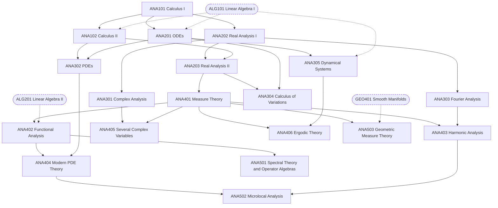

# Analysis Track

Detailed design of the 19 analysis (ANA) courses from the
[catalogue](01-disciplines.md). For each course: its purpose, the units it
covers in order, standard texts for self-study, and a milestone a learner can
use to judge whether they are ready to move on.

Course length and format are deliberately left open; they will be settled
course by course.

## Course map

Solid arrows are prerequisites inside the track. Dashed arrows come from other
areas.

## Routes through the track

The track has one **spine** that every learner follows, and **branches** that
can be taken in any order once their prerequisites are done.

| Route | Courses | Suits learners heading towards |
|---|---|---|
| Spine | ANA101 → ANA102 → ANA202 → ANA203 → ANA401 → ANA402 | Everything beyond the 3xx level |
| Complex | ANA301 → ANA405 | Number theory, algebraic geometry, Riemann surfaces |
| Differential equations | ANA201 → ANA302 → ANA404 → ANA502 | PDE, mathematical physics, numerical analysis |
| Dynamics | ANA201 → ANA305 → ANA406 | Dynamical systems, ergodic theory, mathematical biology |
| Fourier | ANA303 → ANA403 → ANA502 | Harmonic analysis, signal processing, PDE |
| Variational | ANA304, then ANA503 | Geometry, optimal control, mechanics |
| Operators | ANA501 | Quantum mechanics, operator algebras, spectral geometry |

ANA201 (ODEs) only needs ANA101 and ALG101, so it can run alongside the spine
from early on.

## Self-study notes

- **Proof writing starts in ANA202.** It is the first course where every
  exercise is a proof. Learners should write full solutions and, where
  possible, compare them with published solutions or get feedback.
- **Texts are suggestions.** Each course lists a main text and alternatives.
  The units follow the usual order of the main text but are not tied to it.
- **Milestones are self-checks.** If the milestone task feels out of reach,
  revisit the course before moving on.

---

## 1xx — Entry

### ANA101 Calculus I: Single Variable

**Prerequisites:** none (secondary-school algebra and trigonometry).
**Purpose:** fluent computation with limits, derivatives and integrals in one
variable, with intuition for why the main theorems hold.

1. Functions, limits and continuity
2. The derivative: definition, rules, chain rule, implicit differentiation
3. Applications: related rates, optimization, curve sketching, mean value theorem
4. The integral: Riemann sums, fundamental theorem of calculus
5. Techniques of integration: substitution, parts, partial fractions, improper integrals
6. Applications of integration: area, volume, arc length, work
7. Sequences and series: convergence tests, power series
8. Taylor polynomials and Taylor series, with error estimates

**Texts:** Stewart, *Calculus: Early Transcendentals* (main). Spivak,
*Calculus*, or Apostol, *Calculus* Vol. 1, for a more rigorous route.
**Milestone:** find the Taylor series of a function such as ln(1 + x), give its
radius of convergence, and bound the error of a Taylor polynomial on an interval.

### ANA102 Calculus II: Multivariable and Vector Calculus

**Prerequisites:** ANA101, ALG101.
**Purpose:** calculus in several variables, ending with the integral theorems
of vector calculus.

1. Vectors, lines, planes; curves and their derivatives
2. Functions of several variables: limits, partial derivatives, differentiability
3. Gradient, directional derivatives, chain rule, Jacobian matrix
4. Extrema, second-derivative test, Lagrange multipliers
5. Double and triple integrals; change of variables, polar/cylindrical/spherical coordinates
6. Vector fields, line integrals, conservative fields
7. Surfaces and surface integrals
8. Green's, Stokes' and divergence theorems

**Texts:** Marsden & Tromba, *Vector Calculus* (main). Hubbard & Hubbard,
*Vector Calculus, Linear Algebra, and Differential Forms*, for an integrated
linear-algebra approach.
**Milestone:** verify the divergence theorem for a given field on a solid
region by computing both sides.

## 2xx — Core

### ANA201 Ordinary Differential Equations

**Prerequisites:** ANA101, ALG101.
**Purpose:** solve the standard classes of ODEs and understand the qualitative
behaviour of solutions.

1. First-order equations: separable, linear, exact; modelling examples
2. Second-order linear equations: constant coefficients, undetermined coefficients, variation of parameters
3. Linear systems: matrix exponential, eigenvalue methods, phase portraits in the plane
4. Laplace transform and its use for initial-value problems
5. Series solutions and regular singular points
6. Existence and uniqueness: Picard iteration, Lipschitz conditions, Grönwall's inequality
7. Nonlinear systems: equilibria, linearization, Lyapunov stability
8. Boundary-value problems and Sturm–Liouville theory

**Texts:** Boyce & DiPrima, *Elementary Differential Equations and Boundary
Value Problems* (main). Hirsch, Smale & Devaney, *Differential Equations,
Dynamical Systems, and an Introduction to Chaos*, for a more qualitative approach.
**Milestone:** classify the equilibria of a nonlinear planar system and sketch
its phase portrait.

### ANA202 Real Analysis I

**Prerequisites:** ANA101.
**Purpose:** rebuild single-variable calculus rigorously; the first fully
proof-based analysis course.

1. The real numbers: ordered fields, completeness, supremum and infimum
2. Sequences: limits, monotone convergence, Bolzano–Weierstrass, Cauchy sequences
3. Series: convergence tests, absolute and conditional convergence, rearrangements
4. Topology of ℝ: open, closed and compact sets; Heine–Borel
5. Continuity: limits of functions, intermediate and extreme value theorems, uniform continuity
6. Differentiation: mean value theorem, L'Hôpital's rule, Taylor's theorem with remainder
7. The Riemann integral: integrability criteria, fundamental theorem of calculus
8. Sequences and series of functions: uniform convergence, power series, Weierstrass approximation

**Texts:** Abbott, *Understanding Analysis* (main). Rudin, *Principles of
Mathematical Analysis*, or Tao, *Analysis I*, as alternatives.
**Milestone:** prove that a uniform limit of continuous functions is
continuous, and give an example showing pointwise convergence is not enough.

### ANA203 Real Analysis II

**Prerequisites:** ANA202, ANA102.
**Purpose:** analysis on metric spaces and rigorous multivariable calculus.

1. Metric spaces: open and closed sets, convergence, completeness
2. Compactness and connectedness in metric spaces
3. Continuous maps; the contraction mapping theorem
4. Spaces of functions: Arzelà–Ascoli, Stone–Weierstrass
5. Differentiation in ℝⁿ: the derivative as a linear map, chain rule
6. Inverse and implicit function theorems
7. Integration in ℝⁿ: Fubini, change of variables
8. Differential forms and the general Stokes theorem on ℝⁿ

**Texts:** Pugh, *Real Mathematical Analysis* (main). Rudin, *Principles of
Mathematical Analysis*; Munkres, *Analysis on Manifolds*, for units 5–8.
**Milestone:** use the implicit function theorem to show that a given level set
in ℝ³ is locally the graph of a smooth function.

## 3xx — Advanced undergraduate

### ANA301 Complex Analysis

**Prerequisites:** ANA202.

1. Complex numbers, the complex plane, elementary functions
2. Holomorphic functions and the Cauchy–Riemann equations
3. Contour integration; Cauchy's theorem and integral formula
4. Consequences: Liouville, maximum modulus, power series, zeros
5. Laurent series, singularities, the residue theorem
6. Evaluating real integrals by residues
7. Conformal maps, Möbius transformations, Riemann mapping theorem
8. Analytic continuation; the gamma and zeta functions

**Texts:** Stein & Shakarchi, *Complex Analysis* (main). Ahlfors, *Complex
Analysis*; Needham, *Visual Complex Analysis*, for geometric intuition.
**Milestone:** evaluate ∫₀^∞ dx / (1 + x⁴) using the residue theorem.

### ANA302 Partial Differential Equations

**Prerequisites:** ANA102, ANA201.

1. Classification of second-order PDEs; first-order equations and characteristics
2. The wave equation: d'Alembert's formula, domain of dependence
3. The heat equation: fundamental solution, maximum principle
4. Laplace's equation: harmonic functions, mean value property
5. Separation of variables and Fourier series solutions
6. Boundary-value problems in higher dimensions; Bessel and Legendre functions
7. Green's functions
8. Energy methods and uniqueness

**Texts:** Strauss, *Partial Differential Equations: An Introduction* (main).
**Milestone:** solve the heat equation on an interval with given boundary and
initial data, and prove the solution is unique.

### ANA303 Fourier Analysis

**Prerequisites:** ANA202.

1. Fourier series: coefficients, partial sums, Dirichlet and Fejér kernels
2. Pointwise and uniform convergence; Gibbs phenomenon
3. Mean-square convergence and Parseval's identity
4. The Fourier transform on ℝ: Schwartz functions, inversion, Plancherel
5. Poisson summation formula; the heat kernel
6. Finite Fourier analysis and the fast Fourier transform
7. Applications: isoperimetric inequality, equidistribution, Dirichlet's theorem preview

**Texts:** Stein & Shakarchi, *Fourier Analysis: An Introduction* (main).
Körner, *Fourier Analysis*, for applications.
**Milestone:** use Parseval's identity to compute ∑ 1/n⁴.

### ANA304 Calculus of Variations

**Prerequisites:** ANA203, ANA201.

1. Functionals and their first variation; the Euler–Lagrange equation
2. Classical problems: brachistochrone, geodesics, minimal surfaces of revolution
3. Constraints: isoperimetric problems, holonomic constraints
4. Second variation: Legendre and Jacobi conditions, conjugate points
5. Hamiltonian formulation and Noether's theorem
6. Direct method: lower semicontinuity, coercivity, existence of minimizers

**Texts:** Gelfand & Fomin, *Calculus of Variations* (main). van Brunt, *The
Calculus of Variations*, as an alternative.
**Milestone:** solve the brachistochrone problem and check that the solution
satisfies the Jacobi condition.

### ANA305 Dynamical Systems and Chaos

**Prerequisites:** ANA201, ALG101.

1. One-dimensional flows; bifurcations (saddle-node, transcritical, pitchfork)
2. Two-dimensional flows: linear systems, phase plane, conservative systems
3. Limit cycles, Poincaré–Bendixson, Hopf bifurcation
4. Lorenz equations and strange attractors
5. One-dimensional maps: logistic map, period doubling, Feigenbaum constant
6. Chaos: Lyapunov exponents, symbolic dynamics
7. Fractals and fractal dimension

**Texts:** Strogatz, *Nonlinear Dynamics and Chaos* (main).
**Milestone:** locate the period-doubling cascade of the logistic map
numerically and explain the mechanism behind it.

## 4xx — Graduate core

### ANA401 Measure Theory and Integration

**Prerequisites:** ANA203.

1. σ-algebras, measures, outer measure, Carathéodory's construction
2. Lebesgue measure on ℝⁿ; non-measurable sets
3. Measurable functions and the Lebesgue integral
4. Convergence theorems: monotone, Fatou, dominated
5. Product measures and Fubini–Tonelli
6. Lᵖ spaces: Hölder, Minkowski, completeness, duality
7. Signed measures, Radon–Nikodym, Lebesgue decomposition
8. Differentiation: Lebesgue differentiation theorem, absolutely continuous functions

**Texts:** Folland, *Real Analysis* (main). Stein & Shakarchi, *Real Analysis*;
Axler, *Measure, Integration & Real Analysis*.
**Milestone:** prove that Lᵖ is complete.

### ANA402 Functional Analysis

**Prerequisites:** ANA401, ALG201.

1. Normed and Banach spaces; bounded operators
2. Hilbert spaces: projections, Riesz representation, orthonormal bases
3. Hahn–Banach theorem and duality
4. Baire category: uniform boundedness, open mapping, closed graph
5. Weak and weak-* topologies; Banach–Alaoglu; reflexivity
6. Compact operators and Fredholm theory
7. Spectral theorem for compact self-adjoint operators
8. Introduction to unbounded operators and to Banach algebras

**Texts:** Brezis, *Functional Analysis, Sobolev Spaces and Partial
Differential Equations* (main). Kreyszig, *Introductory Functional Analysis
with Applications*, as a gentler start; Conway, *A Course in Functional
Analysis*.
**Milestone:** use the spectral theorem to solve a Fredholm integral equation
with a symmetric kernel.

### ANA403 Harmonic Analysis

**Prerequisites:** ANA401, ANA303.

1. Fourier analysis on 𝕋ⁿ and ℝⁿ revisited in Lᵖ
2. Interpolation: Riesz–Thorin, Marcinkiewicz
3. The Hardy–Littlewood maximal function
4. The Hilbert transform and singular integrals; Calderón–Zygmund theory
5. Littlewood–Paley theory
6. BMO and Hardy spaces
7. Oscillatory integrals and restriction problems (introduction)

**Texts:** Grafakos, *Classical Fourier Analysis* (main). Duoandikoetxea,
*Fourier Analysis*, as a shorter alternative.
**Milestone:** prove that the Hilbert transform is bounded on Lᵖ for 1 < p < ∞.

### ANA404 Modern Theory of PDEs

**Prerequisites:** ANA402, ANA302.

1. Distributions and the Fourier transform of distributions
2. Sobolev spaces: weak derivatives, embeddings, traces
3. Second-order elliptic equations: weak solutions, Lax–Milgram
4. Elliptic regularity and the maximum principle
5. Parabolic equations: Galerkin method, energy estimates
6. Hyperbolic equations: energy estimates, finite speed of propagation
7. Nonlinear problems: fixed-point methods, variational methods

**Texts:** Evans, *Partial Differential Equations* (main). Brezis, as above.
**Milestone:** prove existence and uniqueness of a weak solution to the
Dirichlet problem for a uniformly elliptic operator.

### ANA405 Several Complex Variables

**Prerequisites:** ANA301, ANA401.

1. Holomorphic functions of several variables; power series
2. Hartogs' extension phenomenon
3. Domains of holomorphy and holomorphic convexity
4. Plurisubharmonic functions and pseudoconvexity
5. The ∂̄-problem and Hörmander's L² estimates
6. The Levi problem

**Texts:** Krantz, *Function Theory of Several Complex Variables* (main).
Hörmander, *An Introduction to Complex Analysis in Several Variables*.
**Milestone:** prove Hartogs' extension theorem for holomorphic functions on a
punctured ball in ℂ².

### ANA406 Ergodic Theory

**Prerequisites:** ANA401, ANA305.

1. Measure-preserving systems; Poincaré recurrence
2. Ergodicity; von Neumann and Birkhoff ergodic theorems
3. Mixing properties
4. Invariant measures for continuous maps; unique ergodicity
5. Entropy: measure-theoretic and topological
6. Applications to number theory: equidistribution, Furstenberg's correspondence

**Texts:** Walters, *An Introduction to Ergodic Theory* (main). Einsiedler &
Ward, *Ergodic Theory with a view towards Number Theory*.
**Milestone:** prove that an irrational rotation of the circle is uniquely
ergodic.

## 5xx — Specialized

### ANA501 Spectral Theory and Operator Algebras

**Prerequisites:** ANA402.

1. Unbounded operators: closed, symmetric and self-adjoint operators
2. The spectral theorem for self-adjoint operators
3. Perturbation theory; essential spectrum
4. C*-algebras: Gelfand–Naimark theorems, GNS construction
5. Von Neumann algebras: bicommutant theorem, factors

**Texts:** Reed & Simon, *Methods of Modern Mathematical Physics* Vol. I
(main). Murphy, *C*-Algebras and Operator Theory*.

### ANA502 Microlocal Analysis

**Prerequisites:** ANA404, ANA403.

1. Symbol classes and pseudodifferential operators
2. Symbolic calculus; elliptic parametrices
3. Wave front sets
4. Propagation of singularities
5. Semiclassical analysis and applications

**Texts:** Zworski, *Semiclassical Analysis* (main). Grigis & Sjöstrand,
*Microlocal Analysis for Differential Operators*.

### ANA503 Geometric Measure Theory

**Prerequisites:** ANA401, GEO401.

1. Hausdorff measure and dimension
2. Covering theorems and densities
3. Rectifiable sets; area and coarea formulas
4. Sets of finite perimeter
5. Currents and the Plateau problem

**Texts:** Morgan, *Geometric Measure Theory: A Beginner's Guide* (main).
Maggi, *Sets of Finite Perimeter and Geometric Variational Problems*.

---

## Points to decide for this track

1. **Course format.** Length and structure of each course (to be discussed).
2. **Text choices.** Whether to commit to one main text per course or write
   our own notes that cite several texts.
3. **Possible additions:** a second complex analysis course (elliptic
   functions, conformal mapping in depth), potential theory, nonlinear
   functional analysis, asymptotic analysis (currently in PHY302).
4. **Splitting the 5xx courses.** ANA501 covers two subjects (spectral theory
   and operator algebras) and may work better as two courses.
