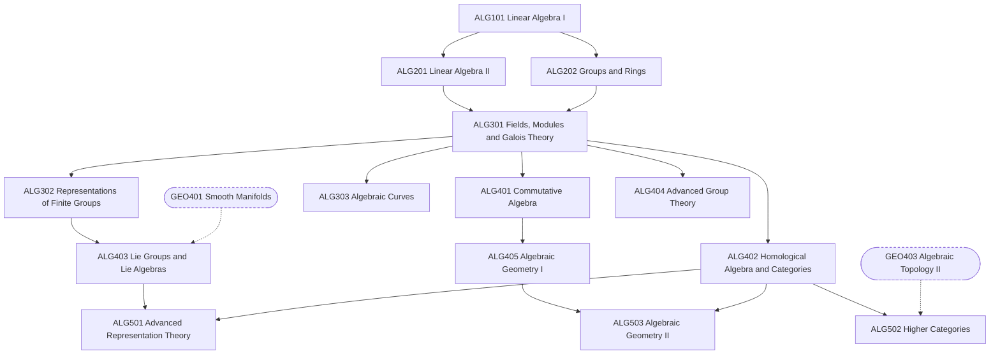

# Algebra Track

Detailed design of the 14 algebra (ALG) courses from the
[catalogue](01-disciplines.md), including algebraic geometry. For each course:
its purpose, the units it covers in order, optional external reading, and a
milestone a learner can use to judge whether they are ready to move on.

As in every track, each course's own material is self-contained; the books
under "Optional reading" are extra and never required. The 5xx courses are
provisional and will be designed in detail much later.

## Course map

Solid arrows are prerequisites inside the track. Dashed arrows come from other
areas.

## Routes through the track

| Route | Courses | Suits learners heading towards |
|---|---|---|
| Spine | ALG101 → ALG201 and ALG202 → ALG301 | Everything beyond the 3xx level, and most other areas |
| Representation theory | ALG302 → ALG403 → ALG501 | Lie theory, mathematical physics, combinatorics |
| Algebraic geometry | ALG303 → ALG401 → ALG405 → ALG503 | Algebraic geometry, arithmetic geometry, number theory |
| Homological | ALG402 → ALG502 | Algebraic topology, algebraic geometry, category theory |
| Group theory | ALG404 | Geometric group theory, finite groups |

ALG201 and ALG202 both need only ALG101, so they can be studied in parallel.
ALG101 is the entry course of the whole series, alongside ANA101.

## Self-study notes

- **Abstraction arrives in ALG202.** It is the first algebra course built
  around axioms and proofs rather than computation. ALG201 makes the same
  change for linear algebra; doing the two in parallel helps each.
- **Examples carry the theory.** Every abstract notion comes with a stock of
  small, fully computed examples (symmetric groups, dihedral groups, ℤ/n,
  polynomial rings, small matrix groups). Learners should know these well
  enough to test conjectures against them.

---

## 1xx — Entry

### ALG101 Linear Algebra I

**Prerequisites:** none.
**Purpose:** concrete linear algebra in ℝⁿ: solving systems, working with
matrices, and the geometry of eigenvectors and orthogonality.

1. Systems of linear equations; Gaussian elimination and row echelon form
2. Matrix algebra; inverses and elementary matrices
3. Vectors in ℝⁿ: dot product, length, lines and planes
4. Subspaces of ℝⁿ: span, linear independence, basis, dimension
5. Linear maps and their matrices; kernel, image and the rank–nullity theorem
6. Determinants: properties, computation, geometric meaning
7. Eigenvalues and eigenvectors; diagonalization
8. Orthogonality: projections, Gram–Schmidt, least squares, orthogonal diagonalization of symmetric matrices

**Optional reading:** Strang, *Introduction to Linear Algebra*; Lay, *Linear
Algebra and Its Applications*.
**Milestone:** orthogonally diagonalize a symmetric 3 × 3 matrix and use the
result to compute a high power of it.

## 2xx — Core

### ALG201 Linear Algebra II

**Prerequisites:** ALG101.
**Purpose:** linear algebra over an arbitrary field, coordinate-free, up to
the canonical forms and the spectral theorem.

1. Fields (ℚ, ℝ, ℂ, finite fields 𝔽ₚ) and abstract vector spaces
2. Linear maps, isomorphisms, quotient spaces, dual spaces
3. Determinants as alternating multilinear forms
4. Eigenvalues, characteristic and minimal polynomials, Cayley–Hamilton theorem
5. Inner product spaces, orthonormal bases, adjoints
6. Spectral theorem for self-adjoint and normal operators; singular value decomposition
7. Jordan canonical form
8. Bilinear and quadratic forms; Sylvester's law of inertia
9. Tensor products (introduction)

**Optional reading:** Axler, *Linear Algebra Done Right*; Halmos,
*Finite-Dimensional Vector Spaces*; Hoffman & Kunze, *Linear Algebra*.
**Milestone:** find the Jordan form of a 4 × 4 matrix and explain it using the
minimal polynomial.

### ALG202 Abstract Algebra I: Groups and Rings

**Prerequisites:** ALG101.
**Purpose:** the basic structures of abstract algebra and the standard
theorems about them.

1. Groups: definition and examples (symmetric, dihedral, matrix groups, ℤ/n)
2. Subgroups, cyclic groups, cosets and Lagrange's theorem
3. Homomorphisms, normal subgroups, quotient groups, isomorphism theorems
4. Group actions: orbit–stabilizer, class equation, Cayley's theorem
5. Sylow theorems; groups of small order
6. Symmetric and alternating groups; simplicity of Aₙ for n ≥ 5
7. Rings, ideals, quotient rings, ring homomorphisms
8. Integral domains, fields of fractions; Euclidean domains, PIDs, UFDs
9. Polynomial rings and irreducibility: Gauss's lemma, Eisenstein's criterion

**Optional reading:** Dummit & Foote, *Abstract Algebra*; Artin, *Algebra*;
Gallian, *Contemporary Abstract Algebra*.
**Milestone:** prove that every group of order 15 is cyclic.

## 3xx — Advanced undergraduate

### ALG301 Abstract Algebra II: Fields, Modules and Galois Theory

**Prerequisites:** ALG202, ALG201.

1. Field extensions, degree, algebraic and transcendental elements
2. Ruler-and-compass constructions: the three classical problems
3. Splitting fields and algebraic closure
4. Separability; finite fields
5. Galois groups and the fundamental theorem of Galois theory
6. Cyclotomic extensions
7. Solvable groups and solvability by radicals; insolubility of the quintic
8. Modules: submodules, quotients, free modules, exact sequences
9. Finitely generated modules over a PID; applications to abelian groups and to rational and Jordan canonical forms

**Optional reading:** Dummit & Foote, *Abstract Algebra*; Stewart, *Galois
Theory*.
**Milestone:** compute the Galois group of x⁴ − 2 over ℚ and list all
intermediate fields of its splitting field.

### ALG302 Representation Theory of Finite Groups

**Prerequisites:** ALG301.

1. Representations, subrepresentations, Maschke's theorem
2. Schur's lemma
3. Characters and the orthogonality relations
4. Character tables
5. Induced representations and Frobenius reciprocity
6. Tensor products and restriction
7. Representations of the symmetric group via Young diagrams
8. Applications: Burnside's pᵃqᵇ theorem

**Optional reading:** James & Liebeck, *Representations and Characters of
Groups*; Serre, *Linear Representations of Finite Groups*.
**Milestone:** construct the character table of S₄.

### ALG303 Introduction to Algebraic Curves

**Prerequisites:** ALG301.

1. Affine plane curves; singular points and tangent lines
2. The projective plane and homogeneous coordinates
3. Intersection multiplicity
4. Bézout's theorem
5. Conics and cubics; the group law on a cubic
6. Rational curves and parametrization
7. Genus and the degree–genus formula; a first look at Riemann–Roch

**Optional reading:** Fulton, *Algebraic Curves*; Kirwan, *Complex Algebraic
Curves*.
**Milestone:** find the singular point of y² = x²(x + 1) and parametrize the
curve by rational functions.

## 4xx — Graduate core

### ALG401 Commutative Algebra

**Prerequisites:** ALG301.

1. Prime and maximal ideals, nilradical and Jacobson radical
2. Modules, exact sequences, tensor products
3. Localization
4. Noetherian rings; Hilbert's basis theorem
5. Integral extensions; going-up and going-down
6. Noether normalization and Hilbert's Nullstellensatz
7. Primary decomposition
8. Dimension theory; Krull's principal ideal theorem
9. Discrete valuation rings and Dedekind domains

**Optional reading:** Atiyah & Macdonald, *Introduction to Commutative
Algebra*; Reid, *Undergraduate Commutative Algebra*; Eisenbud, *Commutative
Algebra with a View Toward Algebraic Geometry*.
**Milestone:** prove Hilbert's Nullstellensatz from Noether normalization.

### ALG402 Homological Algebra and Category Theory

**Prerequisites:** ALG301.

1. Categories, functors, natural transformations
2. Universal properties; limits and colimits
3. Adjunctions and the Yoneda lemma
4. Abelian categories and exact sequences
5. Chain complexes, homology, the long exact sequence, the snake lemma
6. Projective and injective resolutions
7. Derived functors; Ext and Tor
8. Group cohomology (introduction)
9. Spectral sequences (introduction)

**Optional reading:** Riehl, *Category Theory in Context*; Weibel, *An
Introduction to Homological Algebra*.
**Milestone:** show that Tor₁ of ℤ/m and ℤ/n over ℤ is ℤ/gcd(m, n), and
compute Ext¹ of the same pair.

### ALG403 Lie Groups and Lie Algebras

**Prerequisites:** ALG302, GEO401.

1. Matrix Lie groups and their Lie algebras
2. Lie groups as manifolds; the exponential map
3. Lie algebras: ideals, solvable and nilpotent algebras, Engel's and Lie's theorems
4. The Killing form, Cartan's criteria, semisimplicity
5. Representations of sl₂(ℂ)
6. Cartan subalgebras and root systems
7. Dynkin diagrams and the classification of semisimple Lie algebras
8. The Lie group–Lie algebra correspondence; compact Lie groups

**Optional reading:** Hall, *Lie Groups, Lie Algebras, and Representations*;
Erdmann & Wildon, *Introduction to Lie Algebras*; Humphreys, *Introduction to
Lie Algebras and Representation Theory*.
**Milestone:** classify the finite-dimensional irreducible representations of
sl₂(ℂ).

### ALG404 Advanced Group Theory

**Prerequisites:** ALG301.

1. Free groups and presentations
2. Composition series and the Jordan–Hölder theorem
3. Solvable and nilpotent groups
4. p-groups
5. Semidirect products and extensions; the Schur–Zassenhaus theorem
6. Permutation groups and primitivity
7. Transfer and Burnside's normal p-complement theorem
8. Finite simple groups: the families and the statement of the classification

**Optional reading:** Rotman, *An Introduction to the Theory of Groups*;
Isaacs, *Finite Group Theory*.
**Milestone:** classify the groups of order 12 up to isomorphism.

### ALG405 Algebraic Geometry I: Varieties

**Prerequisites:** ALG401.

1. Affine varieties and the Zariski topology
2. Coordinate rings and morphisms
3. Projective varieties
4. Rational maps and birational equivalence
5. Dimension
6. Tangent spaces and smoothness
7. Blowing up
8. Nonsingular curves and divisors (introduction)

**Optional reading:** Shafarevich, *Basic Algebraic Geometry 1*; Hartshorne,
*Algebraic Geometry*, Chapter I.
**Milestone:** find the singular locus of a given surface and resolve a
node by blowing up.

## 5xx — Specialized (provisional)

### ALG501 Advanced Representation Theory

**Prerequisites:** ALG403, ALG402.

1. Highest-weight theory for semisimple Lie algebras
2. The Weyl character formula
3. Verma modules and category O
4. Quantum groups (introduction)

**Optional reading:** Humphreys, *Representations of Semisimple Lie Algebras
in the BGG Category O*; Fulton & Harris, *Representation Theory*.

### ALG502 Higher Categories and Homotopical Algebra

**Prerequisites:** ALG402, GEO403.

1. Simplicial sets
2. Model categories and homotopy categories
3. Derived functors in homotopical algebra
4. Quasi-categories as a model for ∞-categories

**Optional reading:** Hovey, *Model Categories*; Riehl, *Categorical Homotopy
Theory*.

### ALG503 Algebraic Geometry II: Schemes and Cohomology

**Prerequisites:** ALG405, ALG402.

1. Sheaves and ringed spaces
2. Schemes and morphisms of schemes
3. Quasi-coherent sheaves
4. Čech and derived-functor sheaf cohomology
5. Riemann–Roch and Serre duality for curves

**Optional reading:** Vakil, *The Rising Sea*; Hartshorne, *Algebraic
Geometry*.

---

## Points to decide for this track

1. **Prerequisites of ALG302.** Character theory over ℂ needs only groups and
   linear algebra. Lowering the prerequisite from ALG301 to ALG202 and ALG201
   would make representation theory available a course earlier.
2. **ALG303 and ALG405.** The introductory curves course overlaps with the
   start of algebraic geometry. It could stay as a gentle route in, or be
   merged into ALG405.
3. **Complex numbers in ALG101.** ALG101 works over ℝ. Complex eigenvalues
   could be introduced there briefly, or left to ALG201.
