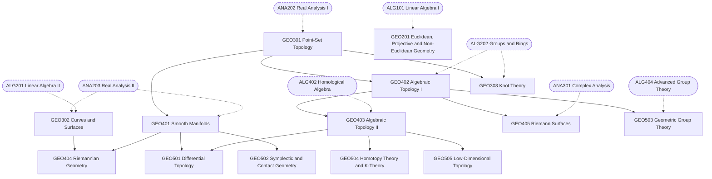

# Geometry and Topology Track

Detailed design of the 14 geometry and topology (GEO) courses from the
[catalogue](01-disciplines.md). For each course: its purpose, the units it
covers in order, optional external reading, and a milestone a learner can use
to judge whether they are ready to move on.

As in every track, each course's own material is self-contained; the books
under "Optional reading" are extra and never required. The 5xx courses are
provisional and will be designed in detail much later.

## Course map

Solid arrows are prerequisites inside the track. Dashed arrows come from other
areas.

## Routes through the track

| Route | Courses | Suits learners heading towards |
|---|---|---|
| Spine | GEO301 → GEO401 and GEO402 → GEO403 | Everything beyond the 3xx level |
| Classical geometry | GEO201 | A standalone course; useful background for GEO302 and ALG303 |
| Differential geometry | GEO302 → GEO404 | General relativity (PHY403), gauge theory (PHY405), geometric analysis |
| Algebraic topology | GEO402 → GEO403 → GEO504 | Homotopy theory, higher categories (ALG502) |
| Manifold topology | GEO401 → GEO501, GEO303 → GEO505 | Differential and low-dimensional topology, knot theory |
| Complex geometry | GEO405 | Number theory (NUM501), algebraic geometry |
| Symplectic | GEO502 | Mechanics, mathematical physics |

The track draws heavily on the other two core areas. GEO301 needs ANA202, and
the spine also needs ANA203 (for GEO401) and ALG202 (for GEO402), so the
geometry track usually starts after the analysis and algebra spines are under
way. GEO201 is the exception: it needs only ALG101.

## Self-study notes

- **Pictures and proofs.** Geometric intuition comes from pictures, but
  arguments must not rely on them. Each lesson pairs a figure with the precise
  statement it illustrates. This makes the series-wide decision on figures
  especially important for this track.
- **Computation alongside theory.** Learners should compute invariants
  (curvatures, fundamental groups, homology groups) for many explicit spaces:
  spheres, tori, projective spaces, surfaces of higher genus, lens spaces.

---

## 2xx — Core

### GEO201 Geometry: Euclidean, Projective and Non-Euclidean

**Prerequisites:** ALG101.
**Purpose:** classical geometry seen through its transformation groups, and
the discovery that Euclid's parallel postulate is independent.

1. Euclid's and Hilbert's axioms; the parallel postulate
2. Isometries of the Euclidean plane and their classification
3. Symmetry groups: rosette, frieze and wallpaper groups
4. Affine geometry
5. The projective plane, homogeneous coordinates, cross-ratio
6. Conics in projective geometry
7. Spherical geometry
8. Hyperbolic geometry: the Poincaré disc and upper half-plane models, isometries, area and angle defect

**Optional reading:** Stillwell, *The Four Pillars of Geometry*; Brannan,
Esplen & Gray, *Geometry*; Hartshorne, *Geometry: Euclid and Beyond*.
**Milestone:** classify the isometries of the Euclidean plane and prove that
each one is a composition of at most three reflections.

## 3xx — Advanced undergraduate

### GEO301 Point-Set Topology

**Prerequisites:** ANA202.

1. Topological spaces, bases, subspace topology
2. Continuous maps and homeomorphisms
3. Product and quotient topologies
4. Connectedness and path-connectedness
5. Compactness; Tychonoff's theorem
6. Countability and separation axioms
7. Urysohn's lemma and the Urysohn metrization theorem
8. Compactifications

**Optional reading:** Munkres, *Topology*; Willard, *General Topology*.
**Milestone:** prove that the square with opposite edges identified is
homeomorphic to the torus S¹ × S¹.

### GEO302 Differential Geometry of Curves and Surfaces

**Prerequisites:** ANA203, ALG201.

1. Parametrized curves and arc length
2. Curvature, torsion and the Frenet–Serret formulas
3. Global theory of curves: the isoperimetric inequality, the four-vertex theorem
4. Regular surfaces
5. The first fundamental form; lengths, angles and area
6. The Gauss map, second fundamental form, principal and Gaussian curvature
7. Gauss's Theorema Egregium
8. Geodesics
9. The Gauss–Bonnet theorem

**Optional reading:** do Carmo, *Differential Geometry of Curves and
Surfaces*; Pressley, *Elementary Differential Geometry*.
**Milestone:** compute the Gaussian curvature of a torus of revolution and
check that its total curvature is 0, as Gauss–Bonnet predicts.

### GEO303 Introduction to Knot Theory

**Prerequisites:** GEO301, ALG202.

1. Knots, links and diagrams
2. Reidemeister moves
3. Colourings and the linking number
4. Seifert surfaces and knot genus
5. The Alexander polynomial
6. The Jones polynomial via the Kauffman bracket
7. The knot group and the Wirtinger presentation (with the fundamental group introduced as needed)
8. Braids

**Optional reading:** Adams, *The Knot Book*; Lickorish, *An Introduction to
Knot Theory*.
**Milestone:** show that the trefoil is not the unknot using tricolourability,
and compute its Jones polynomial.

## 4xx — Graduate core

### GEO401 Smooth Manifolds

**Prerequisites:** GEO301, ANA203.

1. Topological and smooth manifolds; charts and atlases
2. Smooth maps; partitions of unity
3. Tangent spaces and the tangent bundle
4. Immersions, submersions, embeddings; the regular value theorem
5. Sard's theorem and the Whitney embedding theorem
6. Vector fields, flows and the Lie bracket
7. Vector bundles, the cotangent bundle, tensor fields
8. Differential forms and the exterior derivative
9. Orientation, integration on manifolds, Stokes' theorem
10. de Rham cohomology: homotopy invariance and Mayer–Vietoris

**Optional reading:** Lee, *Introduction to Smooth Manifolds*; Tu, *An
Introduction to Manifolds*.
**Milestone:** use the regular value theorem to show that SO(n) is a smooth
manifold, and find its dimension.

### GEO402 Algebraic Topology I

**Prerequisites:** GEO301, ALG202.

1. Homotopy and homotopy equivalence
2. The fundamental group; the fundamental group of the circle
3. The Seifert–van Kampen theorem
4. Covering spaces: lifting, classification, deck transformations
5. CW complexes
6. Simplicial and singular homology
7. Exact sequences, excision, Mayer–Vietoris
8. Cellular homology and the Euler characteristic
9. Applications: Brouwer's fixed-point theorem, invariance of domain, the Jordan curve theorem

**Optional reading:** Hatcher, *Algebraic Topology*; Armstrong, *Basic
Topology*.
**Milestone:** compute the homology groups of real projective space ℝPⁿ.

### GEO403 Algebraic Topology II

**Prerequisites:** GEO402, ALG402.

1. Cohomology and the universal coefficient theorem
2. Cup products and the cohomology ring
3. The Künneth formula
4. Poincaré duality
5. Higher homotopy groups; the long exact sequence of a fibration
6. The Hurewicz and Whitehead theorems
7. Eilenberg–MacLane spaces and representability of cohomology (introduction)

**Optional reading:** Hatcher, *Algebraic Topology*; Bredon, *Topology and
Geometry*.
**Milestone:** compute the cohomology ring of ℂPⁿ and use it to show that ℂP²
is not homotopy equivalent to S² ∨ S⁴.

### GEO404 Riemannian Geometry

**Prerequisites:** GEO401, GEO302.

1. Riemannian metrics and examples
2. Connections and the Levi-Civita connection
3. Geodesics and the exponential map
4. Curvature: Riemann, sectional, Ricci and scalar curvature
5. Jacobi fields and conjugate points
6. Completeness and the Hopf–Rinow theorem
7. Comparison theorems: Rauch, Bonnet–Myers, Cartan–Hadamard
8. Spaces of constant curvature

**Optional reading:** Lee, *Introduction to Riemannian Manifolds*; do Carmo,
*Riemannian Geometry*.
**Milestone:** show that hyperbolic space, in the upper half-space model, has
constant sectional curvature −1.

### GEO405 Riemann Surfaces

**Prerequisites:** ANA301, GEO402.

1. Definitions and examples
2. Holomorphic maps, degree, the Riemann–Hurwitz formula
3. Differential forms on Riemann surfaces
4. Divisors and line bundles
5. The Riemann–Roch theorem
6. Compact Riemann surfaces as algebraic curves
7. The Abel–Jacobi theorem
8. The uniformization theorem (statement and main ideas)

**Optional reading:** Miranda, *Algebraic Curves and Riemann Surfaces*;
Forster, *Lectures on Riemann Surfaces*; Donaldson, *Riemann Surfaces*.
**Milestone:** use Riemann–Hurwitz to find the genus of the curve
y² = f(x), where f is a polynomial of degree 2g + 1 with distinct roots.

## 5xx — Specialized (provisional)

### GEO501 Differential Topology

**Prerequisites:** GEO401, GEO403.

1. Transversality and intersection theory
2. Morse theory
3. Cobordism
4. Vector bundles and characteristic classes: Stiefel–Whitney, Chern, Pontryagin

**Optional reading:** Milnor, *Topology from the Differentiable Viewpoint*;
Guillemin & Pollack, *Differential Topology*; Milnor & Stasheff,
*Characteristic Classes*.

### GEO502 Symplectic and Contact Geometry

**Prerequisites:** GEO401.

1. Linear symplectic algebra
2. Symplectic manifolds and Darboux's theorem; Moser's method
3. Hamiltonian flows
4. Moment maps and symplectic reduction
5. Contact manifolds

**Optional reading:** Cannas da Silva, *Lectures on Symplectic Geometry*;
McDuff & Salamon, *Introduction to Symplectic Topology*.

### GEO503 Geometric Group Theory

**Prerequisites:** GEO402, ALG404.

1. Cayley graphs and group actions on spaces
2. Quasi-isometries and the Švarc–Milnor lemma
3. Growth of groups
4. Hyperbolic groups
5. Ends of groups

**Optional reading:** Löh, *Geometric Group Theory: An Introduction*; Clay &
Margalit (eds.), *Office Hours with a Geometric Group Theorist*.

### GEO504 Homotopy Theory and K-Theory

**Prerequisites:** GEO403.

1. Fibrations and cofibrations
2. Spectral sequences; the Serre spectral sequence
3. Stable homotopy and spectra
4. Vector bundles and topological K-theory
5. Bott periodicity

**Optional reading:** Hatcher, *Vector Bundles and K-Theory*; May, *A Concise
Course in Algebraic Topology*; McCleary, *A User's Guide to Spectral
Sequences*.

### GEO505 Low-Dimensional Topology

**Prerequisites:** GEO403.

1. Surfaces and mapping class groups
2. 3-manifolds: Heegaard splittings and prime decomposition
3. Geometrization (overview)
4. 4-manifolds: intersection forms, the theorems of Freedman and Donaldson
5. Kirby calculus

**Optional reading:** Rolfsen, *Knots and Links*; Farb & Margalit, *A Primer
on Mapping Class Groups*; Gompf & Stipsicz, *4-Manifolds and Kirby Calculus*.

---

## Points to decide for this track

1. **Prerequisites of GEO302.** Curves and surfaces needs multivariable
   calculus and linear algebra, but not the full rigour of ANA203. Lowering
   the prerequisite to ANA102 and ALG201 would let learners meet differential
   geometry earlier.
2. **GEO303 and the fundamental group.** Knot theory uses the knot group
   before GEO402 defines fundamental groups in general. The course can
   introduce what it needs, or require GEO402 instead of GEO301.
3. **GEO201 has no successors.** It is a standalone course. It could become a
   recommended prerequisite for GEO302 and ALG303, or stay optional.
